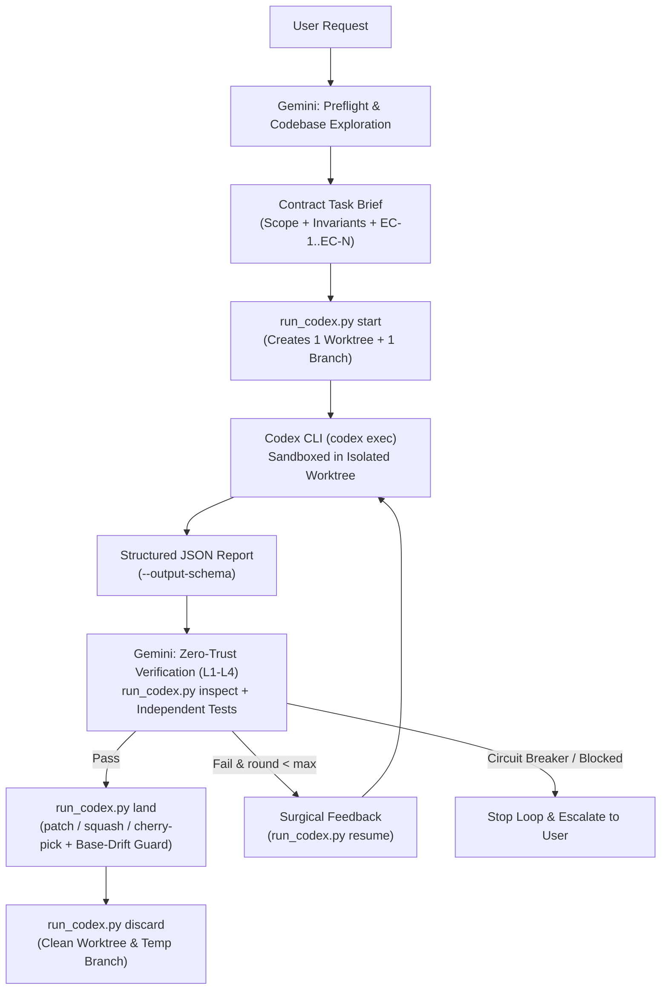

# Gemini Codex Orchestrator

> **1 Codex Session = 1 Isolated Git Worktree** — An agent skill & CLI harness that lets **Gemini** act as Tech Lead / Verifier while delegating bounded implementation tasks to **Codex CLI** (`codex exec`) with strict contracts, edge-case auditing, circuit breakers, and safe landing.

[English](./README.md) | [简体中文](./README_ZH.md)

---

## Why This Skill Exists

Simply forwarding a user's prompt from one coding agent to another usually fails in practice:
- The worker modifies files in your main working tree, tangling its changes with your uncommitted edits.
- The worker claims *"All tests passed"* while only testing the happy path, weakening assertions, or inserting `@ts-ignore` / `# noqa`.
- Parallel runs collide on `git index`, files, or `codex exec resume --last`.
- A stuck worker loops indefinitely and burns tokens without converging.

**Gemini Codex Orchestrator** solves this by separating **planning + verification (Gemini)** from **isolated implementation (Codex)**, backed by a zero-dependency Python worktree lifecycle script (`run_codex.py`) and a strict JSON Schema worker report (`--output-schema`).

---

## Target Scenarios

### Great Fit
- **Multi-file features & bounded refactors**: Gemini explores the repository first, defines file scope, invariants, and numbered edge cases (`EC-1`, `EC-2`, ...), dispatches Codex in an isolated worktree, and independently verifies the diff and tests.
- **Edge-case-heavy bug fixes & hardening**: Forces Codex to map every required edge case ID to both code and a concrete test location in structured JSON output; Gemini audits every claim against the real `git diff` and newly created files.
- **Parallel sub-task execution with zero main-tree pollution**: Your main working tree can remain dirty or active while multiple Codex workers run concurrently in independent Git worktrees outside the repository.
- **High-speed, cost-efficient dual-model workflow**: Let Gemini handle architectural reasoning, edge-case enumeration, and final code review, while pinning Codex workers to a fast, low-reasoning profile by default (`gpt-6.2-astra` + `low` + `fast`, customizable via flags or env vars), escalating only when a subtask genuinely requires deeper reasoning.

### Not Recommended For
- Trivial one-line edits or quick Q&A (direct execution is faster).
- Non-Git directories (Git worktree isolation requires a Git repository).

---

## Architecture



---

## 7 Real-World Boundary Guardrails Built In

1. **Dirty Base Protection**: Git worktrees branch from a commit (`HEAD`), not uncommitted edits. `start` refuses to run on a dirty main tree unless you explicitly confirm with `--allow-dirty-base`, preventing silent context loss.
2. **Safe Dependency Bootstrap (APFS CoW + Secret Blocking)**: Pass `--copy-deps "node_modules,.venv"` to clone ignored dependency directories via macOS APFS copy-on-write (`cp -cR`, with standard fallback on Linux). Sensitive filenames (`.env*`, `*.pem`, `*.key`, `id_rsa`, `credentials.*`) are blocked **before** any worktree is created.
3. **Git History & Sandbox Isolation**: Worker briefs forbid `git commit / push / reset / checkout / rebase`. All Git mutations happen outside the Codex sandbox under Gemini's control. (If a test suite genuinely needs index writes, `--allow-git-dir` grants access *only* to that worktree's `.git/worktrees/<name>` metadata directory.)
4. **Out-of-Repo Worktrees**: Worktrees, registries, and logs live outside the project root under `~/.cache/codex-worktrees/` (configurable via `CODEX_ORCHESTRATOR_HOME`), never polluting `git status` or search tools.
5. **Strict 1:1 `run_id ↔ session_id ↔ worktree_path` Binding**: Extracts `session_id` / `thread_id` from `--json` JSONL events and binds it in a local registry. `resume` always targets the exact bound session and worktree—never `--last`.
6. **Zero-Trust L1–L4 Verification & Anti-Cheating Audit**: `inspect` audits both tracked diffs **and newly created untracked files**, flagging touched tests, lockfiles, `@ts-ignore`, `# noqa`, `# type: ignore`, `.skip(`, bare `except:`, and `--no-verify`.
7. **Circuit Breaker & Base-Drift Landing Guard**: Hard round cap (`--max-rounds`, default `3`) stops runaway loops. Before `land`, base drift is checked; if main `HEAD` moved while Codex was working, landing requires explicit acknowledgement (`--allow-base-drift`) and mandates post-land re-testing in the main repo before cleanup.

---

## Prerequisites

- **Git** (with `git worktree` support)
- **Python 3.10+** (standard library only, zero pip dependencies)
- **Codex CLI** installed and authenticated (`codex --version`)

---

## Installation

### Option 1: Install from `.skill` Release Asset (Recommended)

Download `codex-orchestrator.skill` from [GitHub Releases](https://github.com/riverLaugh/gemini-codex-orchestrator/releases). A `.skill` file is a standard ZIP archive with Unix permissions preserved:

```bash
# Global install (available across all projects in Antigravity / Gemini)
unzip codex-orchestrator.skill -d ~/.gemini/config/skills/

# Or project-scoped install (shared via your repository)
unzip codex-orchestrator.skill -d <your-repo>/.agents/skills/
```

### Option 2: Install as an Antigravity Plugin

This repository includes a root `plugin.json`, so you can clone it directly as a plugin:

```bash
git clone https://github.com/riverLaugh/gemini-codex-orchestrator.git \
  ~/.gemini/config/plugins/gemini-codex-orchestrator
```

### Option 3: Copy Directly from Source

```bash
git clone https://github.com/riverLaugh/gemini-codex-orchestrator.git
cp -R gemini-codex-orchestrator/skills/codex-orchestrator ~/.gemini/config/skills/
```

---

## Usage

Once installed, simply prompt Gemini naturally:
- *"Use `codex-orchestrator` to delegate implementing rate-limiting middleware to Codex, make sure edge cases are covered, and independently verify the diff and tests."*
- *"Split these two modules into parallel Codex worktrees, audit both results, and land them as clean patches."*

### CLI Reference (`run_codex.py`)

Gemini invokes the bundled harness at `skills/codex-orchestrator/scripts/run_codex.py`:

| Command | Purpose |
| :--- | :--- |
| `preflight --repo <dir>` | Check Codex binary, Git root, branch/HEAD, dirty files, submodules, and active runs |
| `start --repo <dir> --slug <name> --brief <file>` | Create isolated worktree & branch, launch `codex exec` with `--output-schema`, bind session |
| `inspect --run <run_id> [--full-diff]` | Return structured worker report, tracked diff, untracked file previews, drift info, and audit warnings |
| `resume --run <run_id> --feedback <file>` | Continue the exact bound Codex session in the same worktree (enforces `--max-rounds` circuit breaker) |
| `land --run <run_id> --mode <patch\|squash\|cherry-pick>` | Apply verified changes back to main repo (`patch` checks atomically via `git apply --check` first) |
| `discard --run <run_id>` | Remove worktree and temporary branch after landing or when abandoning an approach |
| `list [--repo <dir>] [--all]` | List tracked worktree runs and their status/model/round |
| `gc [--days 7] [--dry-run]` | Garbage-collect old `landed`/`abandoned` worktrees, branches, and logs |

---

## Configuration & Model Pinning

By default, `run_codex.py` explicitly pins Codex launch settings so execution does not silently inherit arbitrary global `~/.codex/config.toml` defaults (such as heavy `high` reasoning):

| Setting | Default | CLI Flag | Environment Variable |
| :--- | :--- | :--- | :--- |
| Model | `gpt-6.2-astra` | `--model` | `CODEX_ORCHESTRATOR_MODEL` |
| Reasoning effort | `low` | `--reasoning-effort` (`low\|medium\|high\|xhigh\|max\|ultra`) | `CODEX_ORCHESTRATOR_REASONING_EFFORT` |
| Service tier | `fast` | `--service-tier` (`fast` or `standard` to disable `fast_mode`) | `CODEX_ORCHESTRATOR_SERVICE_TIER` |
| Worktree & registry root | `~/.cache/codex-worktrees` | — | `CODEX_ORCHESTRATOR_HOME` |

On tough rework turns, Gemini can selectively escalate without changing global defaults:
```bash
python3 skills/codex-orchestrator/scripts/run_codex.py resume \
  --run "<run_id>" \
  --feedback "/tmp/feedback.md" \
  --reasoning-effort medium
```

---

## Repository Layout

```text
gemini-codex-orchestrator/
├── LICENSE
├── README.md
├── README_ZH.md
├── plugin.json
├── scripts/
│   └── build_skill.py                           # Reproducible .skill packer
└── skills/
    └── codex-orchestrator/
        ├── SKILL.md                             # Manager-Worker SOP (5 phases)
        ├── scripts/
        │   └── run_codex.py                     # 1-session-1-worktree lifecycle CLI
        ├── resources/
        │   ├── task_brief_template.md           # Contract brief template
        │   └── worker_report.schema.json        # Strict JSON Schema for --output-schema
        └── references/
            └── edge_case_checklist.md           # 6-category edge-case & test-integrity checklist
```

### Reproducible Packaging

```bash
python3 scripts/build_skill.py
# -> dist/codex-orchestrator.skill
```

---

## License

[MIT](./LICENSE)
