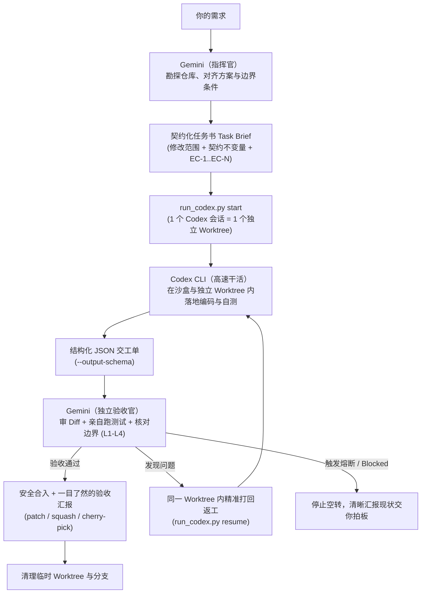

# Gemini Codex Orchestrator

> **Gemini 指挥，Codex 干活 —— 既能看得懂，又能拉满生产力。**

[English](./README.md) | [简体中文](./README_ZH.md)

---

## 核心理念：既看得懂，又把生产力拉满

单用一个 AI 写代码，经常陷入两难：要么自己一步步盯着改、速度慢；要么全放手交给 Agent 狂写，最后甩过来一大坨黑盒 Diff，看不明白也不敢合并。

**Gemini Codex Orchestrator** 把两者的强项彻底拆开再组合：

| 分工 | 角色 | 带给你的核心体验 |
| :--- | :--- | :--- |
| **指挥官 & 验收官** | **Gemini** | **全程看得懂、控得住。** 先帮你读代码、对齐方案和边界条件；写完后亲自审 diff、独立复跑测试，把“改了什么、每条边界怎么覆盖、测试结果如何”整理成一眼能看懂的验收结论。 |
| **主力执行引擎** | **Codex CLI** | **编码生产力直接拉满。** 默认以高速低延迟档位（`gpt-6.2-astra` + `low` + `fast`）执行，配合 **1 个会话 = 1 个独立 Git Worktree**，支持多任务并行干活，不踩主分支、不污染你的本地改动。 |

你只需要跟表达清晰、全局视野强的 **Gemini** 对齐需求与看验收报告；底层由隔离的 **Codex** 火力全开写代码、跑自测——**掌控感和吞吐量全都要**。

---

## 适用场景

### 非常推荐
- **跨文件功能开发与重构（告别黑盒代码）**：跟 Gemini 说清目标即可；Gemini 先摸清代码结构、划清修改范围与编号边界条件（`EC-1`, `EC-2`, ...）再派给 Codex，最后呈现清晰的验收总结，你始终知道每行改动在干什么。
- **多任务并行拉满产出**：把互不重叠的模块、修 Bug、重构拆成多个 Codex 会话并行推进。每个会话独占一个仓库外的 Git Worktree，互不抢文件、不打扰你当前正在改的主工作区。
- **边界条件复杂、容错要求高的任务**：提前把边界清单写入任务书，通过 `--output-schema` 强制 Codex 逐条回填实现与测试位置，再由 Gemini 独立复测与反作弊审计，杜绝“只测主路径”或“改弱断言交差”。
- **高性价比的双模型组合**：重规划、重理解、重验收交给 Gemini；高吞吐代码落地默认走 Codex 的 `gpt-6.2-astra` + `low` + `fast` 极速档，只有真正遇到硬骨头返工时才按需升档（`--reasoning-effort medium/high`）。

### 不需要用
- 顺手改一两行代码或纯技术问答（直接让 Gemini 处理更快）。
- 非 Git 目录（Worktree 强隔离依赖 Git 仓库）。

---

## 工作流程



---

## 底层保障：内置的 7 项工程防护

为了让“Gemini 指挥、Codex 干活”在真实工程仓库里稳定可靠（而不是玩具脚本），配套的零依赖 Python 脚本 `run_codex.py` 把最容易踩的 7 个坑全部做成了硬护栏：

1. **1 会话 = 1 仓库外独立 Worktree**：worktree 与日志默认放在 `~/.cache/codex-worktrees/`，完全不污染你的主分支、`git status` 和全局搜索。
2. **脏工作区基线拦截**：`git worktree` 默认从 `HEAD` 切出，主工作区有未提交改动时默认拒绝静默丢失上下文，确认任务不依赖未提交改动时传入 `--allow-dirty-base` 即可安全隔离开发。
3. **依赖秒级写时复制 + 敏感文件硬拦截**：`--copy-deps "node_modules,.venv"` 在 macOS APFS 上使用 `cp -cR` 写时复制（零污染、秒级就绪，Linux 自动降级标准复制）；建 worktree 前自动拦截 `.env*`、`*.pem`、`*.key`、`id_rsa`、`credentials.*`。
4. **禁止 Codex 乱改 Git 历史**：任务书明确禁止 `git commit / push / reset / checkout / rebase`，所有 Git 状态操作统一由 Gemini 在沙盒外执行。
5. **1:1 精确会话绑定（告别 `--last` 串盘）**：自动从 `--json` 事件流提取 `session_id` / `thread_id` 并与 `run_id`、`worktree_path` 绑定，并行多个 Codex 绝对不会串会话。
6. **零信任反作弊扫描**：`inspect` 同时检查 tracked diff 与**新建未跟踪文件**，自动标记测试文件改动、锁文件改动以及新增的 `@ts-ignore`、`# noqa`、`# type: ignore`、`.skip(`、裸 `except:`、`--no-verify`。
7. **硬熔断 + 基线漂移保护**：默认 `--max-rounds 3` 防止死循环烧 token；合入前检测主分支 `HEAD` 是否在开发期间前进过，若漂移则强制提醒合入后在主仓库复测再清理。

---

## 快速安装

### 环境依赖
- **Git**（支持 `git worktree`）
- **Python 3.10+**（纯标准库，零第三方依赖）
- **Codex CLI** 已安装并登录（`codex --version`）

### 方式一：下载 `.skill` 安装包（推荐）

前往 [GitHub Releases](https://github.com/riverLaugh/gemini-codex-orchestrator/releases) 下载 `codex-orchestrator.skill`（标准 ZIP 格式，已保留可执行权限）：

```bash
# 全局安装（所有项目直接生效）
unzip codex-orchestrator.skill -d ~/.gemini/config/skills/

# 或项目级安装（随项目仓库共享给团队）
unzip codex-orchestrator.skill -d <你的项目>/.agents/skills/
```

### 方式二：作为 Antigravity Plugin 直接克隆安装

```bash
git clone https://github.com/riverLaugh/gemini-codex-orchestrator.git \
  ~/.gemini/config/plugins/gemini-codex-orchestrator
```

### 方式三：从源码拷贝 Skill 目录

```bash
git clone https://github.com/riverLaugh/gemini-codex-orchestrator.git
cp -R gemini-codex-orchestrator/skills/codex-orchestrator ~/.gemini/config/skills/
```

---

## 使用示例

安装完成后，直接自然语言告诉 Gemini 即可：
- *“用 `codex-orchestrator` 把这个限流中间件交给 Codex 在独立 worktree 里实现，把边界条件测全，你独立验收后再给我一份清晰的改动说明。”*
- *“把这两个模块的重构拆成两个并行的 Codex worktree 一起干，两边各自验收完再合回主工作区。”*

---

## 脚本子命令一览（`run_codex.py`）

| 子命令 | 作用 |
| :--- | :--- |
| `preflight --repo <dir>` | 检查 Codex CLI、Git 仓库根、分支/HEAD、未提交改动、子模块与活跃会话 |
| `start --repo <dir> --slug <name> --brief <file>` | 创建独立 worktree 与临时分支，带 `--output-schema` 启动 `codex exec` 并绑定会话 |
| `inspect --run <run_id> [--full-diff]` | 返回交工报告、tracked diff、未跟踪文件预览、基线漂移状态与可疑代码告警 |
| `resume --run <run_id> --feedback <file>` | 在同一 worktree 上精准续聊对应会话（强制执行 `--max-rounds` 熔断上限） |
| `land --run <run_id> --mode <patch\|squash\|cherry-pick>` | 将验收通过的改动安全合回主仓库（`patch` 先做 `git apply --check` 原子预检） |
| `discard --run <run_id>` | 合入后清理或放弃方案时彻底移除 worktree 与临时分支 |
| `list [--repo <dir>] [--all]` | 查看所有受控 worktree 会话的状态、模型档位与轮次 |
| `gc [--days 7] [--dry-run]` | 清理超过 N 天的历史 `landed` / `abandoned` worktree、分支与日志 |

---

## 模型与速度档位配置

`run_codex.py` 默认显式锁定高速执行档位，避免静默继承全局 `~/.codex/config.toml` 里较慢的重推理配置：

| 配置项 | 默认值 | CLI 参数 | 环境变量 |
| :--- | :--- | :--- | :--- |
| 模型 | `gpt-6.2-astra` | `--model` | `CODEX_ORCHESTRATOR_MODEL` |
| 推理强度 | `low` | `--reasoning-effort`（`low\|medium\|high\|xhigh\|max\|ultra`） | `CODEX_ORCHESTRATOR_REASONING_EFFORT` |
| 速度档位 | `fast` | `--service-tier`（`fast`，传 `standard` 可关闭 `fast_mode`） | `CODEX_ORCHESTRATOR_SERVICE_TIER` |
| Worktree 与状态目录 | `~/.cache/codex-worktrees` | — | `CODEX_ORCHESTRATOR_HOME` |

遇硬核返工时可单次升档而不改动全局默认：
```bash
python3 skills/codex-orchestrator/scripts/run_codex.py resume \
  --run "<run_id>" \
  --feedback "/tmp/feedback.md" \
  --reasoning-effort medium
```

---

## 仓库结构与本地复现打包

```text
gemini-codex-orchestrator/
├── LICENSE
├── README.md
├── README_ZH.md
├── plugin.json
├── scripts/
│   └── build_skill.py                           # 可复现、脱敏的 .skill 打包脚本
└── skills/
    └── codex-orchestrator/
        ├── SKILL.md                             # 5 阶段指挥与验收 SOP
        ├── scripts/
        │   └── run_codex.py                     # 1 会话 1 Worktree 生命周期脚本
        ├── resources/
        │   ├── task_brief_template.md           # 契约化任务书模板
        │   └── worker_report.schema.json        # 传给 --output-schema 的严格 JSON Schema
        └── references/
            └── edge_case_checklist.md           # 6 大类边界条件与反测试作弊清单
```

本地复现构建 `.skill`：
```bash
python3 scripts/build_skill.py
# 输出 dist/codex-orchestrator.skill
```

---

## 开源协议

[MIT](./LICENSE)
