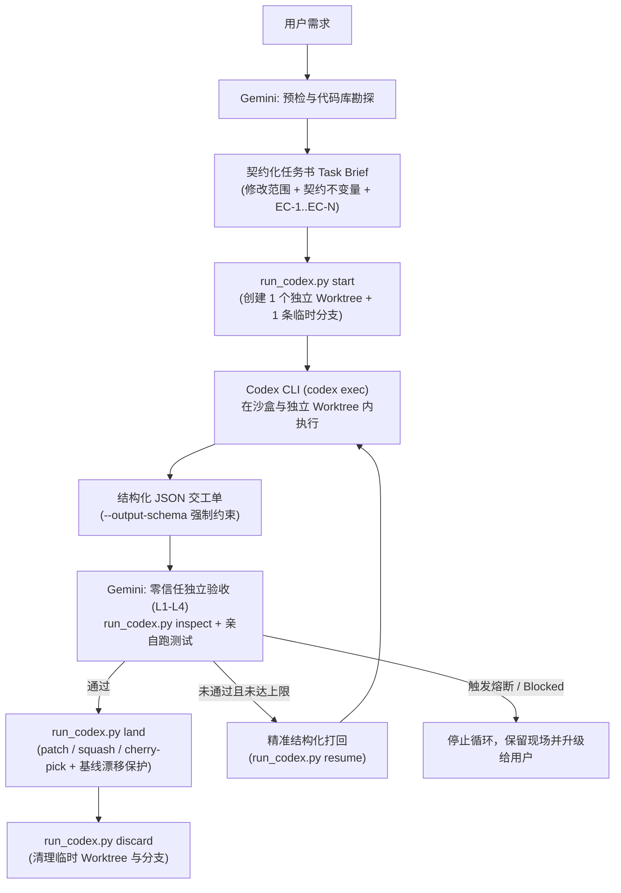

# Gemini Codex Orchestrator

> **1 个 Codex 会话 = 1 个独立 Git Worktree** —— 一套面向多 Agent 协作的 Skill 与编排脚本：由 **Gemini 担任 Tech Lead / 验收官**（勘探代码、划定修改边界、枚举边界条件、独立复测与审计 diff），委派 **Codex CLI**（`codex exec`）在完全隔离的 Git Worktree 中落地编码，内置结构化交付协议、反测试作弊审计、熔断止损与安全合入机制。

[English](./README.md) | [简体中文](./README_ZH.md)

---

## 为什么需要这个 Skill

直接把需求扔给另一个编码 Agent 干活，实战中常见四大翻车：
- **污染主工作区**：Codex 直接在当前分支改代码，和你未提交的本地改动搅成一团，验收和回滚都极其痛苦。
- **口头“全部通过”不可信**：只测 Happy Path、偷偷放宽既有测试断言、或者塞 `@ts-ignore` / `# noqa` / `.skip()` 强行绿灯。
- **并发与续聊串盘**：多个任务并行时互相踩 `git index` 和文件，用 `codex exec resume --last` 还会串到别的终端会话。
- **失控死循环**：遇到沙盒缺依赖或方向跑偏时反复空转，白烧 token。

**Gemini Codex Orchestrator** 通过 **契约化派单 + 独立 Worktree 隔离 + 零信任 L1–L4 验收 + 硬熔断机制**，把双模型协作变成可审计、可回滚、可并行的工程流程。

---

## 适用场景

### 推荐使用场景
- **跨文件功能实现与有界重构**：先由 Gemini 读懂仓库现状、敲定接口契约与编号边界条件（`EC-1`, `EC-2`, ...），再把边界清晰的实现单派给 Codex，在独立 worktree 中完成并由 Gemini 独立验收。
- **高边界条件密度的 Bug 修复与加固**：通过 `codex exec --output-schema` 强制 Codex 对每条 `EC-x` 回填处理逻辑与具体测试位置；Gemini 对照真实 `git diff` 与新建文件逐条核查，杜绝“只改主路径”或“弱化断言”。
- **多子任务并行开发且不打扰主工作区**：主工作区即使有未提交改动也能保持不动；Gemini 可同时拉起多个彼此独立的 Codex worktree 并行干活，互不冲突，合入前自动检测基线漂移。
- **高性价比、低延迟的双模型分工**：重思考（需求拆解、架构设计、边界条件排查、最终 Review）交给 Gemini；具体落地执行默认锁定轻量高速档位（`gpt-6.2-astra` + `low` + `fast`，可按需覆写），仅在遇到难题时单次升档（`--reasoning-effort medium/high`）。

### 不适用场景
- 纯问答、简单信息查询或微小单行修改（直接改更快）。
- 非 Git 目录（Worktree 隔离依赖 Git 仓库）。

---

## 整体架构与闭环流程



---

## 内置的 7 项工程边界防护

1. **脏工作区基线拦截（Dirty Base Protection）**：`git worktree` 从 commit（默认 `HEAD`）切出，不会包含主工作区未提交的改动。若主工作区脏了，`start` 默认拒绝执行，直到你确认任务不依赖这些改动并显式传入 `--allow-dirty-base`，杜绝 Codex 改在旧代码上。
2. **依赖写时复制与敏感文件硬拦截**：支持 `--copy-deps "node_modules,.venv"`，在 macOS APFS 上用 `cp -cR` 秒级写时复制依赖目录（既省空间又完全写隔离，Linux 自动降级标准复制）；前置拦截 `.env*`、`*.pem`、`*.key`、`id_rsa`、`credentials.*` 等敏感文件，且校验在建 worktree 之前完成，失败零孤儿残留。
3. **Git 历史与沙盒边界**：任务书禁止 Codex 执行 `git commit / push / reset / checkout / rebase`，所有 Git 状态操作统一由 Gemini 在沙盒外完成；若个别测试工具必须写索引，可通过 `--allow-git-dir` 仅放行该 worktree 专属的 `.git/worktrees/<name>` 子目录。
4. **Worktree 仓库外隔离**：所有 worktree、注册表和日志统一存放在项目外部（默认 `~/.cache/codex-worktrees/`，可通过 `CODEX_ORCHESTRATOR_HOME` 自定义），不污染主仓库 `git status` 和代码搜索。
5. **严格 1:1 `run_id ↔ session_id ↔ worktree_path` 绑定**：从 `--json` JSONL 事件流自动提取 `session_id` / `thread_id` 并持久化绑定，`resume` 永远精确续聊对应会话与目录，彻底杜绝 `--last` 串会话。
6. **零信任 L1–L4 验收与反作弊扫描**：`inspect` 同时扫描 tracked diff 与**新建未跟踪文件**，自动标记测试文件变更、锁文件变更以及新增的 `@ts-ignore`、`# noqa`、`# type: ignore`、`.skip(`、裸 `except:`、`--no-verify`。
7. **硬熔断与基线漂移复测保护**：默认 `--max-rounds 3` 硬熔断防止死循环；`land` 前自动检测主分支 `HEAD` 是否在开发期间前进，若发生基线漂移则先拦截提醒，要求合入后在主仓库复测通过再删除 worktree。

---

## 环境依赖

- **Git**（支持 `git worktree`）
- **Python 3.10+**（纯标准库实现，零第三方依赖）
- **Codex CLI** 已安装并完成认证（`codex --version`）

---

## 安装方式

### 方式一：下载 `.skill` 安装包（推荐）

前往 [GitHub Releases](https://github.com/riverLaugh/gemini-codex-orchestrator/releases) 下载 `codex-orchestrator.skill`（标准 ZIP 格式，已保留脚本执行权限）：

```bash
# 全局安装（所有项目可用）
unzip codex-orchestrator.skill -d ~/.gemini/config/skills/

# 或项目级安装（随项目仓库共享）
unzip codex-orchestrator.skill -d <你的项目>/.agents/skills/
```

### 方式二：作为 Antigravity Plugin 直接克隆安装

本仓库根目录已提供标准 `plugin.json`，可直接作为插件安装：

```bash
git clone https://github.com/riverLaugh/gemini-codex-orchestrator.git \
  ~/.gemini/config/plugins/gemini-codex-orchestrator
```

### 方式三：从源码拷贝 Skill 目录

```bash
git clone https://github.com/riverLaugh/gemini-codex-orchestrator.git
cp -R gemini-codex-orchestrator/skills/codex-orchestrator ~/.gemini/config/skills/
```

---

## 使用示例

安装完成后，直接向 Gemini 发出协作指令即可，例如：
- *“用 `codex-orchestrator` 把这个限流中间件的实现交给 Codex，在独立 worktree 里做，补齐边界条件测试并由你独立验收 diff 和测试。”*
- *“把这个重构拆成两个互不重叠的子任务，并行开两个 Codex worktree 跑，逐个验收后再合入。”*

### 编排脚本子命令一览（`run_codex.py`）

| 子命令 | 作用 |
| :--- | :--- |
| `preflight --repo <dir>` | 检查 Codex CLI、Git 仓库根、当前分支/HEAD、未提交改动、子模块与活跃任务 |
| `start --repo <dir> --slug <name> --brief <file>` | 创建独立 worktree 与临时分支，带 `--output-schema` 启动 `codex exec` 并绑定会话 |
| `inspect --run <run_id> [--full-diff]` | 输出 Codex 交工报告、tracked diff、未跟踪文件预览、基线漂移状态与可疑代码告警 |
| `resume --run <run_id> --feedback <file>` | 在同一 worktree 上续聊绑定的 Codex 会话（强制执行 `--max-rounds` 熔断上限） |
| `land --run <run_id> --mode <patch\|squash\|cherry-pick>` | 将验收通过的改动合回主仓库（`patch` 模式先做 `git apply --check` 原子预检） |
| `discard --run <run_id>` | 合入后清理或放弃方案时彻底移除 worktree 与临时分支 |
| `list [--repo <dir>] [--all]` | 查看所有受控 worktree 会话的状态、模型档位与轮次 |
| `gc [--days 7] [--dry-run]` | 清理超过 N 天的历史 `landed` / `abandoned` worktree、分支与日志 |

---

## 模型锁定与自定义配置

`run_codex.py` 默认显式锁定启动参数，避免 `codex exec` 静默继承全局 `~/.codex/config.toml` 中较重或不一致的配置：

| 配置项 | 默认值 | CLI 参数 | 环境变量 |
| :--- | :--- | :--- | :--- |
| 模型 | `gpt-6.2-astra` | `--model` | `CODEX_ORCHESTRATOR_MODEL` |
| 推理强度 | `low` | `--reasoning-effort`（`low\|medium\|high\|xhigh\|max\|ultra`） | `CODEX_ORCHESTRATOR_REASONING_EFFORT` |
| 速度档位 | `fast` | `--service-tier`（`fast`，或传 `standard` 关闭 `fast_mode`） | `CODEX_ORCHESTRATOR_SERVICE_TIER` |
| Worktree 与状态根目录 | `~/.cache/codex-worktrees` | — | `CODEX_ORCHESTRATOR_HOME` |

遇复杂返工时可单次升档而不影响默认配置：
```bash
python3 skills/codex-orchestrator/scripts/run_codex.py resume \
  --run "<run_id>" \
  --feedback "/tmp/feedback.md" \
  --reasoning-effort medium
```

---

## 仓库结构

```text
gemini-codex-orchestrator/
├── LICENSE
├── README.md
├── README_ZH.md
├── plugin.json
├── scripts/
│   └── build_skill.py                           # 可复现、脱敏的 .skill 打包脚本
└── skills/
    └── codex-orchestrator/
        ├── SKILL.md                             # 5 阶段指挥与验收 SOP
        ├── scripts/
        │   └── run_codex.py                     # 1 会话 1 Worktree 生命周期脚本
        ├── resources/
        │   ├── task_brief_template.md           # 契约化任务书模板
        │   └── worker_report.schema.json        # 传给 --output-schema 的严格 JSON Schema
        └── references/
            └── edge_case_checklist.md           # 6 大类边界条件与反测试作弊清单
```

### 本地复现打包 `.skill`

```bash
python3 scripts/build_skill.py
# 输出 dist/codex-orchestrator.skill
```

---

## 开源协议

[MIT](./LICENSE)
